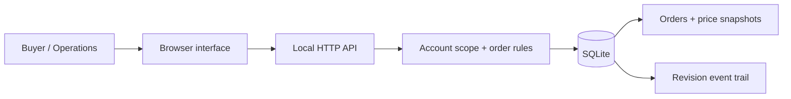

# B2B Ordering Portal

[](https://github.com/nsdmalik/b2b-ordering-portal/actions/workflows/test.yml)

**Regional pricing, case-pack rules, and revision-aware preorders in one working reference application.**

A distributor in Canada should see Canadian prices, submit valid case quantities, and revise an order without overwriting a teammate's newer version. Operations should control the preorder window while retaining the prices each buyer actually submitted.

This portal implements that workflow with a small Python service, SQLite, and a responsive browser interface. All accounts, products, and prices are fictional.

## Walk through an order

| Step | What the application does |
| --- | --- |
| Select North Supply | Loads Canadian prices and CAD totals. |
| Add six Studio storage cases | Calculates a CAD 144.00 order using server-side prices. |
| Switch to Coast Supply | Loads US prices; North Supply's orders are not shown. |
| Revise an order from two tabs | Rejects the stale second update with HTTP 409. |
| Close the window as Operations | Rejects new submissions and revisions. |

The browser never supplies an authoritative price. Each saved order includes its currency, revision, and line-price snapshot. Revisions use current regional prices, while the event trail preserves previous submissions.

[Order rules and persistence](orders.py) · [HTTP boundary tests](test_server.py)

## Run locally

Python 3.11 or later. No dependencies or cloud accounts.

```sh
python3 server.py
# Open http://127.0.0.1:8081
python3 -m unittest -v
```

Use the account selector to try Canadian and US buyers, then switch to Operations to review all orders or close the preorder window. Data persists in `orders.sqlite3`; use `--database another.sqlite3` for a separate demo or `--port 8082` for another port.

## Engineering decisions

| Concern | Implementation |
| --- | --- |
| Regional pricing | The server resolves account region and reads regional prices. The browser submits only SKU and quantity. |
| Quantity rules | Positive integer case-pack multiples, unique SKUs, bounded quantities. |
| Money | Integer cents and explicit currency; no floating-point price arithmetic. |
| Revisions | Expected revision numbers reject stale updates with HTTP 409. |
| Price changes | Submitted line prices are stored. Revisions explicitly use current prices. |
| Account boundaries | Buyers can view and revise their own orders; administrators can view all orders and configure the campaign. |
| Atomic writes | `BEGIN IMMEDIATE` covers availability checks, order changes, and the append-only application event trail. |
| Local browser boundary | Loopback binding, allowed Host headers, same-origin POST requests, HttpOnly session cookies, static-file allowlist. |



## Try a revision conflict

1. Submit an order as North Supply.
2. Open two tabs and select Revise on that order in both.
3. Save the first tab, then attempt to save the second.
4. The second write is rejected until the order is refreshed.

Revising an order reprices every line at the current regional price. The interface calls this out before saving. Previous submissions remain in the event trail.

## API

All POST requests require JSON and an Origin matching the local Host. A demo session cookie scopes requests.

| Route | Purpose |
| --- | --- |
| `POST /api/session` | Select `north-ca`, `coast-us`, or `admin` using `{ "actor": "north-ca" }`. |
| `GET /api/state` | Scoped catalog, currency, preorder window, and orders. |
| `POST /api/orders` | `{ "lines": [{ "sku": "STUDIO-CASE", "quantity": 6 }] }`. Include `id` and `revision` for an update. |
| `POST /api/config` | Administrator only: `{ "open": false }`, or `{ "sku": "STUDIO-CASE", "region": "CA", "cents": 3000 }`. |

## Scope

This is a local reference application, not a hosted commerce service. Selecting a demo account is deliberately not production authentication. Sessions are in memory and cleared on restart. There are no payments, inventory reservations, automated cutoff scheduler, tax calculations, or fulfillment integrations. The preorder window is manually controlled.

Before a real deployment, replace demo role selection with an identity provider, enforce server-managed account membership, use TLS and secure cookies, add session expiry, rate limits and operational monitoring, and define tax, reservation and fulfillment rules. SQLite writes are serialized; this demo makes no distributed throughput claims. The event trail is application-maintained, not tamper-proof storage.

Independent public implementation by [Nauman Masood](https://nsdmalik.dev). [MIT license](LICENSE).
